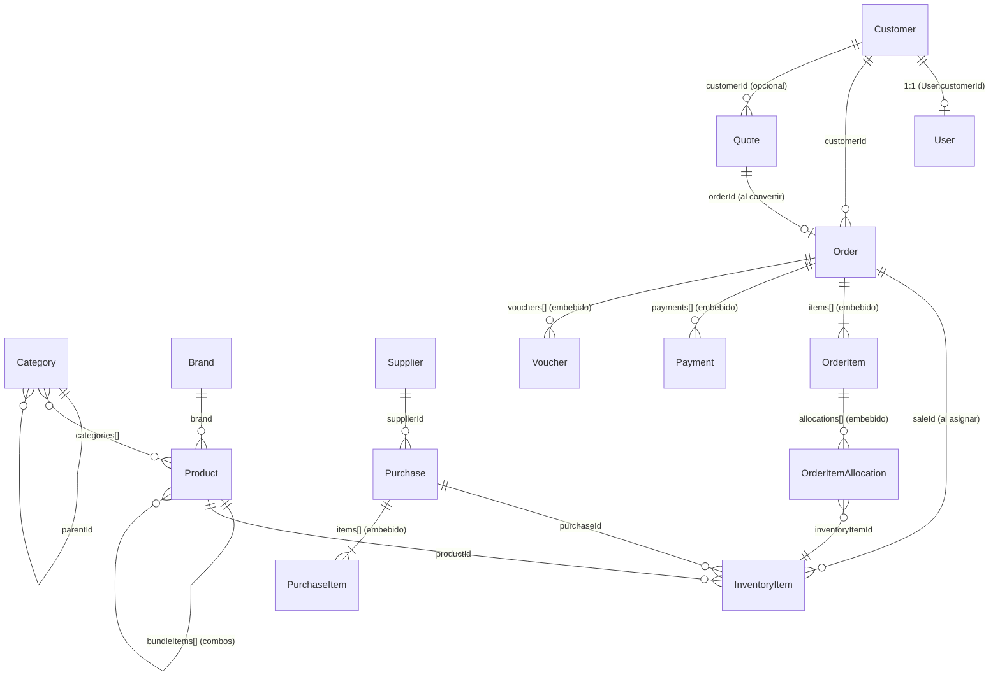

# MGR Techno — Documentación técnica y funcional

> Documento base para entender el sistema y ampliar funcionalidades.
> Verificado contra el código de la rama `main` el 2026-10-22. Donde el código tiene una incoherencia o un defecto, se indica como **⚠ Observación** y se concentra en la sección 12.
> Convenciones del código: nombres de variables y módulos en inglés; mensajes, comentarios y UI en español (Argentina).

## Índice
1. [Visión general](#1-visión-general)
2. [Requerimientos](#2-requerimientos)
3. [Arquitectura](#3-arquitectura)
4. [Modelo de datos (entidades)](#4-modelo-de-datos-entidades)
5. [Reglas de negocio transversales](#5-reglas-de-negocio-transversales)
6. [Flujos de trabajo](#6-flujos-de-trabajo)
7. [Referencia de la API](#7-referencia-de-la-api)
8. [Frontend: tienda y panel](#8-frontend-tienda-y-panel)
9. [Integraciones externas](#9-integraciones-externas)
10. [Configuración y despliegue](#10-configuración-y-despliegue)
11. [Guía para ampliar el sistema](#11-guía-para-ampliar-el-sistema)
12. [Deuda técnica y defectos conocidos](#12-deuda-técnica-y-defectos-conocidos)
13. [Glosario](#13-glosario)

---

## 1. Visión general

**MGR Techno** es un e-commerce de hardware y computación para Argentina (`mgrtechno.com.ar`) con un ERP liviano integrado. Reemplaza a un WooCommerce anterior: aún existen redirecciones 301 y rutas 410 para URLs viejas, y el campo `wooId` en categorías.

Dos grandes superficies:

| Superficie | Ruta | Usuarios | Propósito |
|---|---|---|---|
| Tienda pública | `app/(store)` | Clientes e invitados | Catálogo, carrito, checkout, cuenta |
| Panel de administración | `app/admin` | Rol `administrator` | Catálogo, pedidos, inventario, compras, presupuestos, facturación AFIP, comparador de distribuidores |

Más: feeds XML para comparadores de precios, webhooks de Mercado Pago y emisión de comprobantes fiscales.

### Stack

| Capa | Tecnología |
|---|---|
| Framework | Next.js 16.2 (App Router; `proxy.ts` reemplaza a `middleware.ts`), React 19, TypeScript 5 |
| Estilos | Tailwind CSS 4, `lucide-react` |
| Datos | MongoDB + Mongoose 9. Usa **transacciones** → requiere replica set / Atlas |
| Auth | next-auth 4 (Credentials: contraseña o magic link), sesión JWT |
| Cliente | Zustand (carrito en `localStorage`, clave `mgr-cart`) |
| Validación | Zod 4 |
| Pagos | SDK `mercadopago` (Checkout Pro + webhook) |
| Archivos | Cloudinary (imágenes de producto y PDFs de comprobantes) |
| PDF | Puppeteer (local) / `@sparticuz/chromium` + `puppeteer-core` (Vercel) |
| Email | Resend |
| Fiscal | AFIP: WSAA + WSFEv1 + Padrón (SOAP; firma CMS con `node-forge`) |
| Otros | Recharts (dashboard), TipTap (descripciones), Vercel Analytics, Meta Pixel |
| Deploy | Vercel, con proxy HTTP saliente opcional (`instrumentation.ts` + `undici`) |

> `AGENTS.md` advierte que esta versión de Next.js tiene cambios incompatibles: antes de escribir código de framework, leer `node_modules/next/dist/docs/`.

---

## 2. Requerimientos

### 2.1 Requerimientos funcionales

**Tienda**
- RF-01 Navegar catálogo por categoría (incluye descendientes), con filtros por atributos dinámicos, orden, paginación (16 por página) y búsqueda de texto.
- RF-02 Ver ficha de producto con galería, atributos, stock, precio (regular/oferta), combos y versión Outlet.
- RF-03 Carrito persistente en el navegador que no permite superar el stock disponible.
- RF-04 Cotizar envío por código postal (Andreani, Vía Cargo, envío local, retiro en local).
- RF-05 Comprar como invitado o logueado; el sistema crea cliente y usuario si no existen.
- RF-06 Pagar con Mercado Pago (redirección) o transferencia bancaria (instrucciones por email y pantalla de éxito).
- RF-07 Registro, login con contraseña, login por magic link, recuperación de contraseña.
- RF-08 "Mi cuenta": perfil, historial de pedidos, cambio de contraseña.
- RF-09 Páginas informativas y legales (cómo comprar, envíos, métodos de pago, cambios, FAQ, privacidad, términos).
- RF-10 Recibir emails transaccionales en cada hito del pedido.

**Administración**
- RF-20 CRUD de productos (simples y combos), edición/alta rápida, imágenes, descripción enriquecida, atributos por categoría, duplicar a Outlet, indicador de "salud" del producto.
- RF-21 CRUD de categorías (árbol) con definición de atributos filtrables heredables; CRUD de marcas.
- RF-22 Alta manual de pedidos (incluye "PC Armada" con componentes a medida), cambio de estado, registro/edición/eliminación de pagos parciales.
- RF-23 Asignar inventario (series o lotes) a pedidos pagados con sugerencia FIFO.
- RF-24 Compras a proveedores con recepción parcial/total, carga de series y fallas de Outlet.
- RF-25 Presupuestos con ítems internos, de distribuidor o manuales; PDF; conversión a pedido.
- RF-26 Comprobantes: recibo no fiscal, factura fiscal A/B con CAE de AFIP, notas de crédito/débito; PDF, descarga y envío por email.
- RF-27 Comparador de precios y stock en distribuidores (Elit y NewBytes activos; Invid implementado pero deshabilitado).
- RF-28 Dashboard de ventas e ingresos.
- RF-29 Gestión de clientes y proveedores (autocompletado de proveedor desde el padrón AFIP).

**Marketing / SEO**
- RF-30 Feeds XML (Google Merchant, HardGamers, BuscaHard, BestGaming), sitemap, robots, Schema.org, Meta Pixel.

### 2.2 Requerimientos no funcionales
- RNF-01 **Integridad de stock**: toda operación que mueva stock o cree/cancele pedidos es transaccional y no puede dejar `availableStock` negativo.
- RNF-02 **Autorización**: `/admin`, `/api/admin/*` y `/api/afip/*` sólo accesibles con `role === "administrator"`.
- RNF-03 **Confianza en el servidor**: precios, stock, IVA y descuentos de envío se recalculan en backend; el pago se confirma consultando a Mercado Pago, no por el body del webhook.
- RNF-04 **Serverless**: conexión a Mongo cacheada, pool de 10, timeout de selección 5 s; PDFs con Chromium empaquetado.
- RNF-05 **Rendimiento de catálogo**: caché con `unstable_cache` (tag `catalog-products`), ISR en home (12 h), feeds con `revalidate = 3600`, sitemap diario.
- RNF-06 **Cumplimiento fiscal AR**: IVA incluido en precios de venta, discriminado por alícuota (10,5 % / 21 %); factura A/B con CAE y QR AFIP.
- RNF-07 **Disponibilidad en migración**: redirecciones 301 desde URLs de WooCommerce y 410 para rutas de WordPress.
- RNF-08 **Secretos**: nunca en el repo; sólo variables de entorno (sección 10).

### 2.3 Requisitos de infraestructura
MongoDB con replica set (transacciones), cuenta Vercel, Cloudinary, Resend, Mercado Pago (access token), certificado y clave AFIP (en base64), credenciales Andreani y de distribuidores, webhook de Discord.

---

## 3. Arquitectura

### 3.1 Capas

```
Navegador ─► app/(store) | app/admin  (Server/Client Components)
                │
                ▼
        app/api/**/route.ts      HTTP: parseo, auth, status codes
                │
                ▼
        services/<dominio>/*.ts  Reglas de negocio, transacciones (1 función por archivo)
                │
                ▼
        models/*.ts              Esquemas Mongoose
        lib/mappers/*            Documento DB → DTO (types/shared)
        lib/validators/*         Esquemas Zod de entrada
```

- `types/backend/` = forma del documento en DB. `types/shared/` = DTO serializable que consumen front y back.
- Las páginas de servidor suelen llamar a servicios directamente (no pasan por `/api`).
- `proxy.ts` es el único punto de middleware (ver 3.2).

### 3.2 `proxy.ts`
Orden de evaluación:
1. **Rutas muertas** (`/cart-2`, `/my-account`, `/wp-admin`, `/wp-login.php`, `/wp-content`, `/xmlrpc.php`) → `410` + `X-Robots-Tag: noindex`.
2. **Mantenimiento**: si `MAINTENANCE_MODE === "true"`, reescribe lo público a `/mantenimiento` (excepto `/_next`, archivos con `.`, `/mantenimiento` y rutas protegidas).
3. **Protección**: `/admin`, `/api/admin/*`, `/api/afip/*` → sin token `401`, rol distinto de `administrator` `403` (respuesta JSON, también para páginas `/admin`).
4. Matcher: todo excepto `/api/webhooks/*`.

### 3.3 Autenticación
- `lib/auth.ts`: bcrypt (costo 12), `getUserByEmail`, `generateVoucherToken` (HMAC-SHA256 del id de comprobante con `NEXTAUTH_SECRET`, 32 hex) para descargas públicas.
- `app/api/auth/[...nextauth]`: un único `CredentialsProvider` con dos modos:
  - **Contraseña**: `username` (email) + `password`.
  - **Magic link**: `magicToken` = JWT firmado con `NEXTAUTH_SECRET` (15 min) emitido por `POST /api/auth/magic-link`; se verifica en la página `/auth/verify`.
- El JWT/sesión lleva `customerId`, `billing`, `tipoDocumento`, `numeroDocumento`, `role`.
- Modelo: `User` (login) 1:1 `Customer` (datos de facturación). El rol por defecto es `customer`; los administradores se asignan manualmente en DB.

### 3.3 Convenciones de código
- Cada handler/servicio llama a `connectDB()` (conexión cacheada en `global.mongoose`).
- Operaciones multi-documento: `mongoose.startSession()` + `withTransaction` (o `startTransaction` manual). Pasar `session` a **todas** las consultas internas.
- Los modelos se registran con `models.X || model("X", Schema)` (compatible con HMR). `models/index.ts` reexporta Brand, Category, Customer, InventoryItem, Order, Product, User, Quote, Purchase, Supplier.
- Alias `@/*` → raíz del repo.
- Después de mutar productos: `revalidateProductsCache()` (`services/products/getCatalogProducts.ts`).

---

## 4. Modelo de datos (entidades)

### 4.1 Diagrama de relaciones



### 4.2 Product (`models/Product.ts`)

| Campo | Tipo | Notas |
|---|---|---|
| `name`, `slug` | String | `slug` único (se genera con `generateUniqueProductSlug`) |
| `type` | `simple` \| `bundle` | Default `simple`. Combo = `bundle` |
| `regularPrice` | Number | Precio de lista **con IVA incluido**. En combos = suma de componentes |
| `salePrice` | Number \| null | Debe ser `< regularPrice` (validador). En combos es **obligatorio** |
| `effectivePrice` | Number | `salePrice` si existe y es menor, si no `regularPrice`. Es el precio que se cobra |
| `taxRate` | Number | IVA % (10.5 / 21). Si falta, el pedido usa 10.5 |
| `status` | `draft` \| `pending_review` \| `publish` \| `private` | Sólo `publish` es vendible |
| `manageStock` | Boolean | Default true; las compras sólo admiten productos con stock gestionado |
| `hasSerialNumber` | Boolean | Si es true, el inventario es 1 `InventoryItem` por serie. Combos siempre false |
| `availableStock` / `reservedStock` / `totalStock` | Number | Ver 5.2 |
| `isAvailable` | Boolean | `availableStock > 0` (se recalcula en cada movimiento) |
| `bundleItems[]` | `{productId, quantity≥1}` | Sólo combos; no se permite anidar combos |
| `bundleItemsCount` | Number | Suma de cantidades de componentes |
| `isOutlet` | Boolean | Versión con falla/usado; se excluye de feeds XML |
| `hasFreeShipping` | Boolean | Participa de la regla de envío gratis (5.4) |
| `shippingSize` | `small` \| `standard` \| `bulky` | Regla de envío gratis mixto |
| `weight`, `dimensions{length,width,height}` | Number | Base para cotizar envío; en combos se derivan de componentes si faltan |
| `categories[]` | ObjectId→Category | |
| `brand` | ObjectId→Brand | |
| `attributes[]` | `{key,label,value(Mixed),unit}` | Valores filtrables definidos por la categoría |
| `sku`, `mpn`, `gtin` | String | Usados en feeds y búsqueda |
| `image`, `images[]` | String | URLs (Cloudinary) |
| `shortDescription`, `description` | String | HTML (TipTap) |
| `featured` | Boolean | |

Índices: texto en `name`+`sku`; `attributes.key+value`; `bundleItems.productId`; compuesto `status+isAvailable+categories+createdAt`.
**⚠** Los campos `searchKey`/`searchTerms` usados por `lib/search/*` y `scripts/generateSearchTerms.ts` **no existen** en este esquema.

### 4.3 Category, Brand
- **Category**: `name`, `slug`, `parentId` (árbol), `image`, `count`, `menuOrder` (default 999), `wooId` (legado), `syncedAt`, `attributeDefinitions[]` `{key,label,type: select|multiselect|number|boolean|text, options[], unit, required, filterable}`. Los atributos se **heredan** por la jerarquía (`services/categories/getEffectiveCategoryAttributes.ts`).
- **Brand**: `name` y `slug` únicos, `logo`, `description`, `isActive`.

### 4.4 Customer y User
- **Customer**: `email` (único, sparse), `firstName`, `lastName`, `phone`, `billing{...dirección}`, `document{documentType (def. DNI), number}`, `ivaCondition{code: RI|MONOTRIBUTO|CF|EXENTO, afipId}`. Puede existir sin email (alta manual desde admin).
- **User**: `customerId` (único, requerido), `email` único, `password` (hash), `role` (`customer` | `administrator`).
- **ResetToken**: `email`, `token` único, `expiresAt`, `used`. Dura 1 h.

### 4.5 Order (`models/Order.ts`)

| Campo | Notas |
|---|---|
| `customerId`, `customerEmail` | Cliente dueño del pedido |
| `status` | `pending` · `processing` · `shipped` · `ready_for_pickup` · `on_hold` · `completed` · `cancelled` · `refunded` · `failed` |
| `paymentStatus` | `pending` · `partial` · `paid` · `failed` · `refunded` |
| `billing` | Dirección + `document{documentType, number}` (requeridos) |
| `shipping` | Dirección de envío |
| `shippingMethod{method, cost}` | `local_pickup` · `andreani` · `local_shipping` · `viacargo` |
| `source` | `ecommerce` \| `admin` |
| `items[]` | Ver abajo |
| `payments[]` | Ver abajo |
| `subtotal`, `taxTotal`, `total`, `paidAmount`, `remainingAmount`, `datePaid` | Importes en ARS con IVA incluido; `taxTotal` es el IVA contenido |
| `inventoryAllocatedAt` | Marca que el inventario físico ya fue asignado |
| `vouchers[]` | Comprobantes emitidos |
| `notes` | |

**OrderItem** (embebido): `productId`, `name`, `quantity`, `unitPrice` (con IVA, snapshot), `subtotal`, `taxRate` (def. 10,5), `total`, `isBundle`, `bundleComponents[]{productId,name,quantityPerBundle,totalQuantity}` (snapshot de componentes), `allocations[]`.
**OrderItemAllocation**: `inventoryItemId`, `quantity`, `componentProductId`/`componentName` (si el ítem es combo/PC armada).
**Payment** (embebido, con `_id`): `method` (`cash|bank_transfer|debit_card|credit_card|mercadopago|other`), `status` (`pending|paid|failed|refunded`, def. `paid`), `amount`, `reference`, `paidAt`, `notes`.
**⚠** `createOrderSchema` acepta además el método `cod`, que no existe en el enum de `Payment`.

**Voucher** (embebido): `type` (`non_fiscal_receipt|fiscal_invoice|credit_note|debit_note`), `number`, `status` (`draft|issued|cancelled|replaced`), `generatedAt`, `url`, `publicId` (Cloudinary), `fiscalData`, `relatedVoucherId`, `relatedVoucherType`, `cancelledAt`, `cancelReason`. `fiscalData` es obligatorio si el tipo no es recibo y el estado es `issued`.
**FiscalData**: `cae`, `caeExpirationDate`, `fiscalNumber`, `fiscalPointOfSale`, `fiscalType` (`A|B`), `afipAuthorizedAt`, `qrData`.

### 4.6 InventoryItem
Unidad física de stock. Dos modos:
- **Serializado** (`product.hasSerialNumber`): 1 documento = 1 unidad con `serialNumber` (único, sparse, obligatorio por validador). `quantity = remainingQuantity = 1`.
- **Por lote**: 1 documento con `quantity` y `remainingQuantity` (se decrementa al vender).

Campos: `productId`, `status` (`available|reserved|sold|defective`), `purchaseId`, `saleId` (apunta al pedido; el `ref` dice `"Sale"` pero el id guardado es el de la orden), `location` (def. `main`), `unitCost` (costo de compra), `defectDescription` (Outlet).
Índices por `productId+status` y `productId+status+createdAt` (para FIFO).

### 4.7 Purchase y Supplier
- **Supplier**: `taxId` (CUIT, único parcial), `name`, `email`, `phone`, `website`, `address{street,city,state,zip,country}`, `contactName`, `notes`, `isActive`.
- **Purchase**: `supplierId`, `supplierName`, `status` (`draft|confirmed|partially_received|received|cancelled`), `currency` (ARS/USD), `exchangeRate`, `items[]{productId,name,quantity,receivedQuantity,unitCost,taxRate (def. 10.5)}`, `document{type: invoice|generic, number, fileUrl, fileName, date}`, `subtotal`, `tax`, `total`, `notes`, `receivedAt`.

### 4.8 Quote (colección `quotes`)
`number` (`PRE-0001-00000001`), `date`, `expirationDate`, `status` (`draft|sent|accepted|expired|rejected|converted`), `customerId` + `customer` (snapshot embebido: nombre, email, teléfono, documento, `ivaCondition` como texto, dirección), `items[]{origin: internal|distributor|manual, productId, distributor, distributorSku, name, sku, image, quantity, costPrice, unitPrice, taxRate, discount, subtotal}`, `currency`, `exchangeRate`, `subtotal` (neto), `ivaTotal`, `discountTotal`, `total`, `notes`, `terms`, `pdfUrl`, `orderId`.

### 4.9 Auxiliares
- **AfipToken**: `ws` (único), `token`, `sign`, `expirationTime` — caché del Ticket de Acceso.
- **Counter**: `_id` string + `seq`. Hoy sólo numera documentos genéricos de compras.

---

## 5. Reglas de negocio transversales

### 5.1 Precios e IVA
- `lib/pricing.ts` centraliza: `getFinalPrice` (oferta vs regular), `getListPrice(price, markup=0.25)` (precio "lista" = +25 %), `getPriceNoTax(price, 1.21)`, `getPricing`.
- Todos los precios de venta **incluyen IVA**. El IVA de un ítem es `subtotal − subtotal/(1+taxRate/100)`.
- Tasas habituales: 10,5 % (default de pedidos, compras y presupuestos) y 21 % (factura fiscal, envío).

### 5.2 Modelo de stock (3 contadores)

| Evento | available | reserved | total |
|---|---|---|---|
| Recepción de compra | +q | — | +q |
| Pedido creado (reserva) | −q | +q | — |
| Inventario asignado (venta efectiva) | — | −q | −q |
| Pedido cancelado **sin** asignar | +q | −q | — |
| Reversión de asignación (cancelar con asignación) | +q | — | +q |

- Implementación única: `services/products/updateProductStock(productId, availableDelta, reservedDelta, session, customComponents?)`. Rechaza si `available + delta < 0`.
- Recalcula `isAvailable` y, al final, el stock de los combos afectados (`recalculateBundlesForProducts`).
- **Combos**: no tienen stock propio; al mover un combo se mueve el stock de **cada componente** (`delta × cantidad`). `availableStock` del combo = mín(⌊stock componente / cantidad⌋).
- **Regla de republicación**: si un producto (o combo) `publish` pasa de 0 a stock > 0, vuelve a `pending_review` para que un admin revise el precio.
- `PC Armada` (pedido manual): se pasan `customComponents` explícitos.

### 5.3 Combos
- Mínimo 1 componente; los duplicados se suman; los componentes deben existir y ser `simple`.
- `regularPrice` = suma de componentes; `salePrice` obligatorio y menor a esa suma.
- Peso = suma; dimensiones estimadas (máx. largo/ancho, suma de alturas) si el combo no las define.

### 5.4 Envío
- `quoteShipping` (`POST /api/shipping`): arma bultos con peso/dimensiones/valor y cotiza en Andreani o Vía Cargo; retiro local = 0.
- En `createOrder` el backend **fuerza** `local_pickup = 0` y `local_shipping = 5000`, y para Andreani/Vía Cargo acepta el costo del front (⚠ 12.2).
- **Regla de envío gratis** (sobre productos reales de la DB):
  - Algún producto con `hasFreeShipping`:
    - todos gratis → costo × 0;
    - entre los no gratis hay alguno `bulky` → × 1;
    - todos los no gratis son `small` → × 0;
    - otro caso → × 0,5.
  - Ninguno con envío gratis → × 1.

### 5.5 Recargo de Mercado Pago
`createOrder`: si algún pago es `mercadopago`, `unitPrice = effectivePrice × 1,10`. (El front muestra ×1,25 — ver 12.1.)

### 5.6 Pagos
- En pedidos `ecommerce` todo pago se fuerza a `pending`; sólo el webhook de MP o el admin lo confirman.
- `paymentStatus`: `paidAmount = Σ pagos pagados`; `0 → pending`, `< total → partial`, `≥ total → paid` (`recalculateOrderPaymentStatus`, `getOrderPaymentStatus`).

### 5.7 Identificadores y numeración

| Documento | Formato | Origen |
|---|---|---|
| Pedido | `_id` de Mongo (se muestra el id completo) | `createOrder` |
| Presupuesto | `PRE-0001-00000001` | último número existente + 1 (`generateQuoteNumber`) |
| Comprobante interno | `REC-` / `FAC-` / `NC-` / `ND-` + `Date.now()` | `generateVoucherNumber` |
| Factura fiscal | `00005-0000NNNN` (punto de venta 5) | último autorizado en AFIP + 1 |
| Documento genérico de compra | `CMP-00000001` | `Counter` |

---

## 6. Flujos de trabajo

### 6.1 Compra en la tienda
1. Carrito (Zustand `mgr-cart`) con tope en `availableStock`.
2. Checkout: datos de facturación/envío → `POST /api/shipping` para cotizar.
3. `POST /api/checkout`:
   1. Sin sesión: busca/crea `Customer` y `User` (contraseña aleatoria) por email.
   2. Valida con `createOrderSchema`.
   3. `createOrder` (transacción): relee productos → verifica `status = publish` y stock → aplica reglas 5.4 y 5.5 → crea `Order` (`status: pending`) → reserva stock (5.2).
   4. Fuera de la transacción: email de confirmación (`sendOrderConfirmationEmail`) y notificación a Discord (no bloqueante).
4. Si el pago es Mercado Pago: crea una `Preference` con `external_reference = orderId`; el front redirige al `init_point`. Si es transferencia: se muestran datos bancarios (`BANK_*`) en `/checkout/success` y por email.
5. **Webhook** (`POST /api/webhooks/mercadopago`): para `topic = payment` consulta `Payment.get(id)` a MP; si `approved`, marca `paymentStatus = paid`, `paidAmount = total` y envía "pago confirmado". Responde 200 siempre.

### 6.2 Ciclo de vida del pedido (`PUT /api/admin/orders/[id]`)

```
pending ─(pago confirmado)─► processing ─► shipped / ready_for_pickup ─► completed
   │                              │
   └────────────► cancelled / refunded / on_hold / failed
```
- No se puede pasar a `processing`, `shipped`, `ready_for_pickup` ni `completed` si el pago no está `paid` (salvo que haya un pago `cash`).
- Marcar pagado un pedido `pending` lo pasa a `processing`.
- **Cancelar**: con `inventoryAllocatedAt` → `reverseInventoryAllocation`; sin asignación → libera reserva (usa `bundleComponents` del snapshot). **Descancelar** vuelve a reservar.
- Emails por transición: pago confirmado, enviado, listo para retirar, completado, cancelado (fallos de email se registran y no abortan).
- Pagos parciales: `POST /payments`, `PATCH|DELETE /payments/[paymentId]`.
- ⚠ El panel usa `constants/status.ts`, cuya lista de estados de pago omite `partial`.

### 6.3 Alta manual de pedido (admin)
`POST /api/admin/orders` toma `customerId`, completa email y facturación desde el cliente y llama `createAdminOrder` (admite "PC Armada" con `ensureCustomPcProduct`, pagos ya cobrados y componentes custom). Ver defectos en 12.4.

### 6.4 Asignación de inventario (`POST /api/admin/orders/[id]/allocate`)
- Precondiciones: `paymentStatus = paid` y `inventoryAllocatedAt` vacío.
- `getAllocationSuggestions` propone series/lotes en orden **FIFO** por `createdAt`, sin repetir dentro de la orden; para combos/PC armada sugiere por componente.
- `allocateInventoryToOrder` (transacción) valida por ítem:
  - serializado: cantidad de series = requerida y todas `available` → pasan a `sold` con `saleId = order._id`;
  - lote: `remainingQuantity ≥ qty` (`$gte` atómico) y Σ asignado = requerido.
- Efecto en producto: `reserved −q`, `total −q`. Marca `inventoryAllocatedAt`.
- `reverseInventoryAllocation` deshace todo (al cancelar).

### 6.4b Productos: publicación y revisión
`draft → pending_review → publish → private`. Un producto que recupera stock estando publicado vuelve a `pending_review` (5.2). `/admin/products` tiene vista de pendientes (`getPendingReviewCount`) y puntaje de salud (`getProductHealth`: SKU, GTIN, imagen, peso, atributos…).

### 6.5 Compras a proveedores
1. `POST /api/admin/purchases` (estado `draft` o `confirmed`): sólo productos con `manageStock`; totales por `calculatePurchaseTotals`; documento genérico → número `CMP-…`.
2. `PUT /api/admin/purchases/[id]` edita (también puede numerar el documento genérico).
3. `POST /api/admin/purchases/[id]/receive` (`receivePurchase`, transacción):
   - Sólo desde `confirmed` o `partially_received`.
   - Valida series sin duplicados en el payload ni en DB y que `cantidad ≤ saldo pendiente`.
   - Outlet: 1 `InventoryItem` por unidad con `defectDescription` (y serie si aplica).
   - Serializado: 1 por serie. Resto: 1 lote.
   - `available += q`, `total += q`; si el producto estaba publicado y volvía de 0 → `pending_review`.
   - Recalcula combos; estado final `partially_received` o `received`; `receivedAt`.
   - `unitCost` se guarda en cada `InventoryItem` (base para margen).

### 6.6 Presupuestos
- Alta/edición (`createQuote`/`updateQuote`): el admin ingresa el precio **con IVA**; `calculateQuoteTotals` discrimina neto (`subtotal`), `ivaTotal`, `discountTotal` y `total` (redondeo a 2 decimales).
- Ítems de tres orígenes: `internal` (catálogo), `distributor` (resultado del comparador, con `costPrice`), `manual`.
- PDF vía Puppeteer (`generateQuotePdf`, `GET /quotes/[id]/pdf`).
- `POST /quotes/[id]/convert` (`convertQuoteToOrder`) → `status = converted`, guarda `orderId`. ⚠ 12.4.

### 6.7 Comprobantes y facturación AFIP
`POST /api/admin/orders/[id]/vouchers/generate` → `generateVoucher`:
1. `validateVoucherGeneration`: factura fiscal exige pedido `paid` y que no exista otra `fiscal_invoice` en estado `issued`; nota de crédito exige comprobante relacionado.
2. Crea el voucher `draft` dentro del pedido.
3. **Fiscal** (`generateFiscalVoucher`, tipo A o B):
   - `getAuth()` obtiene el Ticket de Acceso desde `AfipToken` (renueva ~5 min antes de vencer); si no hay, firma un TRA (PKCS#7) con el certificado y llama a WSAA.
   - `getLastVoucher` → siguiente número; `buildInvoiceRequest` + `buildIvaBreakdown` agrupan IVA por alícuota (el envío entra como ítem al 21 %); `createVoucher` ejecuta `FECAESolicitar` (punto de venta **5**).
   - Genera QR (`lib/afip/qr`) y guarda `fiscalData`.
4. Renderiza PDF (template HTML + Puppeteer), lo sube a Cloudinary (`uploadVoucherPdf`) y pasa el voucher a `issued`.
5. Si falla tras obtener CAE → queda `issued` (se puede regenerar el PDF con `.../regenerate`); si falla antes → `cancelled`.
6. Distribución: descarga admin (`/api/admin/vouchers/[id]/download`), pública con token HMAC (`/api/public/vouchers/[id]/download?token=…`), y reenvío por email (`.../send-email`).

### 6.8 Distribuidores y comparador
`GET /api/admin/distributors/search` → `getDistributorProducts` consulta Elit y NewBytes en paralelo (Invid está implementado en el servicio pero el endpoint lo excluye a propósito), normaliza a `{id, distributor, sku, name, price, stock, image, link}` usando `CATEGORY_MAP` (mapa categoría interna → categoría de cada distribuidor). Los resultados se pueden agregar como ítems de presupuesto.

### 6.9 Feeds y SEO
`app/{google-merchant-feed,hardgamers,buscahard,bestgaming}.xml/route.ts` generan RSS con `g:*` (id, gtin, título, descripción, imagen optimizada, condición `new`/`refurbished`, disponibilidad, precio y precio de oferta, marca, mpn) para productos `publish` + `isAvailable`. `revalidate = 3600`. `sitemap.ts` cubre productos y categorías.

---

## 7. Referencia de la API

Todas las rutas `/api/admin/*` y `/api/afip/*` requieren `role = administrator` (aplicado en `proxy.ts`). Respuestas de error: `{ error: string }`.

### Públicas / cliente
| Método | Ruta | Función |
|---|---|---|
| POST | `/api/auth/register` | Alta de `Customer` + `User` |
| POST | `/api/auth/magic-link` | Envía enlace de acceso (JWT 15 min) por email |
| POST | `/api/auth/forgot-password` | Genera `ResetToken` (1 h) y envía email |
| POST | `/api/auth/reset-password` | Cambia contraseña con token |
| `*` | `/api/auth/[...nextauth]` | NextAuth |
| PUT | `/api/account/profile` | Actualiza perfil/facturación (sesión) |
| PUT | `/api/account/password` | Cambia contraseña (sesión) |
| POST | `/api/shipping` | Cotiza envío `{postcode, items[{id,quantity}], shippingMethod}` |
| POST | `/api/checkout` | Crea pedido (+ preferencia MP si corresponde) |
| GET | `/api/products/search` | Búsqueda para autocompletar |
| GET | `/api/public/vouchers/[voucherId]/download` | Descarga con token HMAC |
| POST | `/api/webhooks/mercadopago` | Notificación de pago (fuera del proxy) |

### Admin
| Método | Ruta | Función |
|---|---|---|
| POST | `/api/admin/products` | Crear producto |
| POST | `/api/admin/products/quick` | Alta rápida |
| PUT / PATCH / DELETE | `/api/admin/products/[id]` | Editar / edición parcial / borrar |
| POST | `/api/admin/products/[id]/duplicate-to-outlet` | Clonar como Outlet |
| POST | `/api/admin/categories` · PUT/DELETE `/[id]` | Categorías |
| GET/POST | `/api/admin/brands` | Marcas |
| GET/POST | `/api/admin/customers` | Clientes |
| GET/POST | `/api/admin/suppliers` | Proveedores |
| POST | `/api/admin/orders` | Pedido manual |
| PUT | `/api/admin/orders/[id]` | Cambiar estado / estado de pago |
| POST | `/api/admin/orders/[id]/payments` | Registrar pago |
| PATCH / DELETE | `/api/admin/orders/[id]/payments/[paymentId]` | Editar / borrar pago |
| POST | `/api/admin/orders/[id]/allocate` | Asignar inventario |
| POST | `/api/admin/orders/[id]/vouchers/generate` | Emitir comprobante |
| POST | `/api/admin/orders/[id]/vouchers/[voucherId]/regenerate` | Regenerar PDF |
| POST | `/api/admin/orders/[id]/vouchers/[voucherId]/send-email` | Enviar por email |
| GET | `/api/admin/vouchers/[voucherId]/download` | Descargar PDF |
| POST | `/api/admin/purchases` · PUT/DELETE `/[id]` | Compras |
| POST | `/api/admin/purchases/[id]/receive` | Recepcionar |
| GET/POST | `/api/admin/quotes` · GET/PUT/DELETE `/[id]` | Presupuestos |
| POST | `/api/admin/quotes/[id]/convert` | Convertir a pedido |
| GET | `/api/admin/quotes/[id]/pdf` | PDF |
| GET | `/api/admin/distributors/search` | Comparador |
| POST/GET | `/api/admin/cloudinary/sign` | Firma de subida directa a Cloudinary |
| POST | `/api/admin/upload` | Subida de archivos |
| GET | `/api/afip/auth`, `/api/afip/test-auth` | Diagnóstico de autenticación AFIP |
| POST | `/api/afip/padron` | Consulta padrón por CUIT |
| GET | `/api/afip/wsfe/last-voucher` | Último comprobante autorizado |

---

## 8. Frontend: tienda y panel

### Tienda (`app/(store)`)
Home (carrusel, categorías, ofertas, novedades — ISR 12 h) · `/productos` y `/productos/categoria/[category]` y `/productos/ofertas` · `/productos/[slug]` · `/checkout` (+ `/checkout/success`) · `/mi-cuenta` · `/login`, `/register`, `/forgot-password`, `/reset-password`, `/auth/verify` · páginas informativas. Componentes en `components/{home,products,productCard,checkout,account,layout,seo,skeletons,ui}`. Estado de carrito en `store/cart.ts`.

### Panel (`app/admin`)
`dashboard` (ventas/ingresos por mes, KPIs; `services/graphs`) · `orders` · `quotes` · `products` (+ pendientes de revisión) · `categories` · `customers` · `purchases` · `comparator`. Componentes en `components/admin`, gráficos en `components/graphs`.

---

## 9. Integraciones externas

| Servicio | Uso | Código | Variables |
|---|---|---|---|
| Mercado Pago | Preferencia + webhook | `app/api/checkout`, `app/api/webhooks/mercadopago` | `MP_ACCESS_TOKEN` |
| Andreani | Cotización por CP/peso/volumen/valor | `lib/andreani.ts` | `ANDREANI_CONTRATO`, `ANDREANI_CLIENTE` |
| Vía Cargo | Cotización en vivo | `lib/viaCargoLive.ts` | — |
| AFIP | WSAA, WSFEv1, Padrón | `lib/afip/**` | `AFIP_CUIT`, `AFIP_CERT_BASE64`, `AFIP_KEY_BASE64`, `AFIP_ENV` |
| Cloudinary | Imágenes y PDFs | `lib/cloudinary.ts` | `CLOUDINARY_CLOUD_NAME`, `_API_KEY`, `_API_SECRET` |
| Resend | Emails (`lib/email.ts`) | | `RESEND_API_KEY` |
| Discord | Aviso de venta nueva | `lib/notifications/discord` | `DISCORD_WEBHOOK_URL` |
| Elit / NewBytes / Invid | Catálogos mayoristas | `services/distributors` | `ELIT_USER_ID`, `ELIT_TOKEN`, `NEWBYTES_USER`, `NEWBYTES_PASSWORD`, `INVID_USER`, `INVID_PASSWORD` |
| Meta Pixel / Vercel Analytics | Tracking | `components/Meta*.tsx` | `NEXT_PUBLIC_META_PIXEL` |

Emails existentes (`lib/email.ts`): confirmación de pedido, pago confirmado, enviado, listo para retirar, completado, cancelado, factura/comprobante fiscal (`sendFiscalInvoiceEmail`), reset de contraseña y magic link.

---

## 10. Configuración y despliegue

**Variables de entorno** (sólo nombres; los valores no deben versionarse):
`MONGODB_URI`, `NEXTAUTH_SECRET`, `NEXTAUTH_URL`, `NEXT_PUBLIC_APP_URL`, `MP_ACCESS_TOKEN`, `AFIP_CUIT`, `AFIP_CERT_BASE64`, `AFIP_KEY_BASE64`, `AFIP_ENV`, `ANDREANI_CONTRATO`, `ANDREANI_CLIENTE`, `CLOUDINARY_CLOUD_NAME`, `CLOUDINARY_API_KEY`, `CLOUDINARY_API_SECRET`, `RESEND_API_KEY`, `DISCORD_WEBHOOK_URL`, `BANK_NAME`, `BANK_OWNER`, `BANK_OWNER_CUIT`, `BANK_ALIAS`, `BANK_CBU`, `ELIT_USER_ID`, `ELIT_TOKEN`, `NEWBYTES_USER`, `NEWBYTES_PASSWORD`, `INVID_USER`, `INVID_PASSWORD`, `NEXT_PUBLIC_META_PIXEL`, `GOOGLE_VERIFICATION`, `MAINTENANCE_MODE`, `PROXY_URL`, `PROXY_USER`, `PROXY_PASS`, `CHROME_EXECUTABLE_PATH`, `VERCEL` (la define la plataforma).

**Comandos**: `npm run dev | build | start | lint`; scripts sueltos con `npx tsx scripts/<archivo>.ts`. No hay tests automatizados.

**Despliegue en Vercel**: `next.config.ts` declara `serverExternalPackages: ["@sparticuz/chromium","puppeteer-core"]` y `outputFileTracingIncludes` para empaquetar el binario de Chromium; sin esto fallan los PDFs. `images.remotePatterns` autoriza los dominios de imágenes (propio, Cloudinary, AFIP, Elit, NewBytes, Invid).
**Salida a internet con IP fija**: si `PROXY_URL` está definido, `instrumentation.ts` instala un `ProxyAgent` global de undici (necesario para servicios que exigen IP autorizada, p. ej. AFIP/Andreani).

---

## 11. Guía para ampliar el sistema

**Nuevo endpoint admin**: crear `app/api/admin/<recurso>/route.ts` → `connectDB()` → validar con Zod (`lib/validators`) → delegar en `services/<dominio>` → responder con el DTO del mapper. La protección de rol ya la aplica `proxy.ts` por prefijo.

**Nuevo estado de pedido**: agregarlo en `models/Order.ts` (enum), `constants/status.ts` (etiquetas), la lógica de transición en `app/api/admin/orders/[id]/route.ts` y, si dispara email, en `lib/email.ts`. Revisar el efecto sobre stock (cancelaciones).

**Nuevo método de pago**: enum en `models/Payment.ts` **y** en `lib/validators/createOrderSchema.ts` (hoy desalineados), recargo en `createOrder` si corresponde, instrucciones en `checkout/success` y emails.

**Nuevo método de envío**: enum en `Order.shippingMethod`, esquema Zod, `services/shipping/quoteShipping.ts`, y la regla de costo forzado/validado en `createOrder`.

**Nuevo atributo de producto filtrable**: definirlo en `Category.attributeDefinitions` (o presets en `constants/hardwareAttributePresets.ts`); el filtrado lo resuelve `extractAttributeFilters` + `getCatalogProducts`.

**Nuevo distribuidor**: agregar su cliente y normalización a `getDistributorProducts.ts`, ampliar `CATEGORY_MAP`, y su host a `images.remotePatterns` si trae imágenes.

**Nuevo feed**: copiar el patrón de `app/buscahard.xml/route.ts` (hoy hay tres casi idénticos: conviene extraer una función compartida).

**Nuevo tipo de comprobante**: `Voucher.type`, prefijo en `generateVoucherNumber`, reglas en `validateVoucherGeneration`, template en `lib/pdf/templates` y, si es fiscal, `buildInvoiceRequest` (códigos de comprobante AFIP).

**Mover stock**: siempre vía `updateProductStock` dentro de una transacción, y llamar a `revalidateProductsCache()` después de commitear cambios visibles en el catálogo.

**Ideas naturales de extensión** (no implementadas): reporte de margen usando `InventoryItem.unitCost`, múltiples depósitos (`InventoryItem.location` ya existe), garantías por serie, notas de crédito automáticas al reembolsar, tests de integración sobre `createOrder`/`receivePurchase`, panel de usuarios/roles.

---

## 12. Deuda técnica y defectos conocidos
Detectados leyendo el código; ninguno fue modificado.

### 12.1 Pagos y precios
1. **Recargo de Mercado Pago inconsistente**: el front muestra ×1,25 (`getListPriceFinal`, `markup = 0.25`), el backend cobra ×1,10 (`createOrder`). El cliente ve un total y paga otro.
2. **Webhook MP**: no valida `x-signature` (aunque reconsulta el pago) y no completa `datePaid`.
3. **`POST /orders/[id]/payments`** no recalcula `paymentStatus` (PATCH/DELETE sí).
4. `createOrderSchema` acepta `cod`; `Payment.method` no lo tiene.

### 12.2 Envíos
5. El costo de Andreani/Vía Cargo viene del front y el backend no recotiza (comentario explícito en `createOrder`).

### 12.3 Fiscal
6. `generateFiscalVoucher` lee `order.billing.document.type`, pero el campo es `documentType` → el QR usa siempre DNI (96).
7. El punto de venta `5` está hardcodeado (`createVoucher`, XML).
8. `lib/afip/client.ts` hace `console.log` del sobre SOAP completo (incluye token y sign); `magic-link` loguea la URL mágica.
9. Número interno de comprobante `PREFIJO-Date.now()`: no correlativo.

### 12.4 Pedidos y presupuestos
10. **`convertQuoteToOrder`** crea un `Order` sin `shippingMethod`, `source` ni `subtotal` (requeridos) y con ítems sin `productId`/`unitPrice` → la validación de Mongoose probablemente falla; tampoco reserva stock.
11. **`createAdminOrder`**: IVA por defecto 21 % (el resto usa 10,5 %), no calcula `taxTotal`/`paidAmount`/`remainingAmount` y guarda `shippingCost` (no existe en el esquema).
12. `generateQuoteNumber` toma el último por `createdAt` (no atómico → posible duplicado bajo concurrencia; el campo es `unique`, por lo que fallaría).
13. `ORDER_PAYMENT_STATUSES` no incluye `partial`.

### 12.5 Legado y consistencia
14. `SyncButton` llama a `/api/sync/*`, que ya no existe (herencia de WooCommerce).
15. `scripts/generateSearchTerms.ts` y `lib/search/*` escriben `searchKey`/`searchTerms`, ausentes del modelo `Product` (Mongoose los ignora en modo estricto).
16. `InventoryItem.saleId` referencia `"Sale"` (modelo inexistente) pero guarda ids de `Order`; `populate` sobre ese campo no funcionaría.
17. Feeds `hardgamers`, `buscahard`, `bestgaming` casi idénticos.
18. Checkout de invitado: si el email ya tiene `User`, el pedido se asocia a ese cliente sin autenticar.
19. `next.config.ts` tiene reglas de redirect duplicadas y comentarios con codificación rota (mojibake).
20. Sin tests automatizados.

---

## 13. Glosario
- **Combo / bundle**: producto compuesto de otros productos simples con precio de oferta propio.
- **Outlet**: unidad con falla o usada, con su propio producto y `defectDescription` por unidad.
- **PC Armada**: pedido manual con componentes a medida; se trata como ítem con `bundleComponents` explícitos.
- **Reserva**: stock apartado al crear el pedido (`reservedStock`).
- **Asignación**: vincular unidades físicas (`InventoryItem`) a un pedido pagado; consume stock real.
- **Serializado**: producto que se controla por número de serie.
- **CAE**: Código de Autorización Electrónico de AFIP.
- **WSAA / WSFE**: servicios web de AFIP de autenticación y de facturación electrónica.
- **TRA**: Ticket de Requerimiento de Acceso firmado que se canjea por token+sign.
- **Magic link**: enlace de un solo uso (JWT 15 min) para iniciar sesión sin contraseña.
- **Distribuidor / mayorista**: Elit, NewBytes, Invid.
